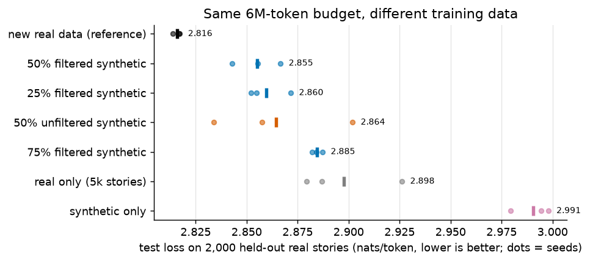
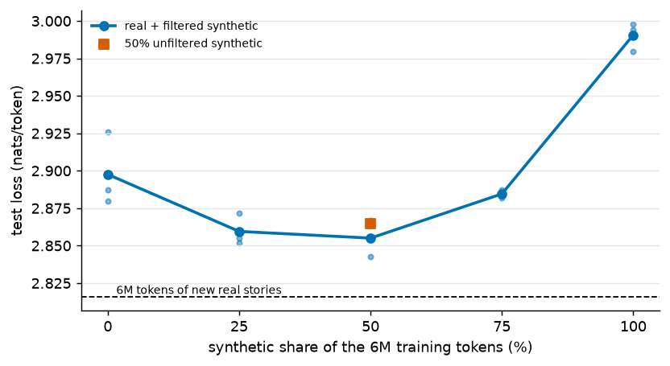

# Synthetic Data Generation and Training

Project 9 of a series on small language models. A larger **teacher** model (TinyStories-33M) writes synthetic
children's stories. A multi-stage filter cleans them, and they are mixed with a *small* amount of real data. Small
**student** models (5.3M parameters) are then trained from scratch on each mixture. The students are always judged on
**held-out real stories**, never on synthetic ones. Everything runs on a CPU.

**Research question:** when real data is scarce, does teacher-generated synthetic data improve a small student at a
fixed training budget, and which quality controls and mixture ratios matter?

**Setup:** the student has only 5,000 real stories (0.97M tokens) and a fixed budget of 6M training tokens. Training
on real data alone therefore means repeating every story about 6 times. The teacher wrote 15,000 stories per pool from
the seed stories' opening sentences and from randomised story frames. The filter kept 93%.

**Short answer:** yes, synthetic data helps, by about half as much as new real data would.
* Replacing half of the repeated real tokens with filtered synthetic stories lowers test loss from **2.898 to 2.855**
  nats/token. The gain holds in all 9 seed pairings and on ASCII-only stories.
* 6M tokens of *other real* stories would give **2.816**. So synthetic data recovers **52%** of the gain of collecting
  more real data, for about one CPU-hour of teacher time.
* **Ratio matters:** 25% ≈ 50% synthetic > 75% > real only > 100% synthetic. Training on synthetic data alone is the
  worst system.
* **Filtering helped only weakly.** It removed just 7% of the stories (mostly ones cut off at the length limit). Its
  advantage (−0.009) is smaller than the seed-to-seed spread of the unfiltered mixture.
* **The number of distinct synthetic stories matters most.** One candidate per prompt (4,649 stories, repeated 3.6×)
  is clearly worse than three (13,966 stories). Lower temperature, a judge model and identical prompts showed no
  effect beyond seed noise. Deduplication found no duplicates at all.



## Results (2,000 held-out real test stories; mean of 3 seeds, lower is better)

| Training data (always 6M tokens) | Test loss | Seed range | vs real only |
|---|---|---|---|
| 6M tokens of new real stories (reference) | **2.816** | 2.814 – 2.817 | −0.082 |
| 50% real + 50% filtered synthetic | **2.855** | 2.843 – 2.867 | −0.043 [−0.047, −0.039] |
| 75% real + 25% filtered synthetic | 2.860 | 2.852 – 2.872 | −0.038 |
| 50% real + 50% *unfiltered* synthetic | 2.864 | 2.834 – 2.902 | −0.033 |
| 25% real + 75% filtered synthetic | 2.885 | 2.882 – 2.887 | −0.013 |
| real only (5,000 stories × 6) | 2.898 | 2.880 – 2.926 | — |
| synthetic only | 2.991 | 2.980 – 2.998 | +0.093 |

Differences are paired by story with 95% bootstrap intervals. Every hypothesis was written down before training, and
its verdict is in `INSTRUCTIONS.md`, Phases 13–14.



### What we learned
1. **Synthetic data is a partial substitute for real data.** It helps a data-starved student, but new real stories
   help about twice as much. Synthetic-only training is worse than repeating 5,000 real stories, because teacher
   stories differ from real ones. About half of that gap comes from encoding debris in real data that the filtered
   synthetic data never contains.
2. **Variety beats volume of the same thing.** More distinct teacher stories helped clearly. Lower temperature made
   the data less varied (distinct word pairs 0.163 vs 0.218) and made its student the most repetitive.
3. **A small teacher at temperature 1.0 does not repeat itself.** Near-duplicate removal (MinHash, Jaccard ≥ 0.5) found
   0 duplicates in 45,000 stories, and contamination with the test set was 0. Real stories share more 13-word phrases
   with the test set (24%) than synthetic ones do (13%).
4. **Calibrate filters on real data.** Every threshold rejects about 1% of real stories, so the filter removes what is
   *unusual*, not what we happen to dislike. The extra judge model removed 932 more stories without a measurable gain.
5. **Check seeds, not only test examples.** The story-level interval said "filtering helps" with high confidence.
   Looking at the seeds showed the unfiltered mixture varies so much that only 5 of 9 seed pairings agree.
6. **Fluency scores can mislead.** The independent scorer (SmolLM2-135M) preferred synthetic-only and low-temperature
   students, which have the worst or nearly worst test loss and the dullest text.
7. **At 5.3M parameters every student loses the plot.** A blind review (by an AI annotator, not a human) rated 90 of 100
   student continuations largely incoherent, against 0 of 20 real ones. Gains of 0.04 nats/token are real but
   invisible to a reader. No student copied a training story.

## Repository

```
synth/                 the code
  prepare_seeds.py     scarce real seeds, fresh real reference, validation and test splits (no overlap)
  templates.py         'open' (real first sentence) and 'frame' (random character/place/goal) prompts
  generate_teacher.py  batched, chunked, resumable teacher sampling with full provenance per record
  parse_outputs.py     schema, normalisation, flags (empty / truncated / malformed)
  filter_quality.py    9-stage filter, thresholds calibrated on real stories
  deduplicate.py       exact + MinHash/LSH near-duplicate detection, 13-gram overlap
  judge.py             model-based judge (Project 1 small model loss)
  dataset_report.py    diversity, length, vocabulary, name concentration
  build_mixtures.py    fixed-budget mixtures of real and synthetic stories
  train_student.py     student training (Project 1 GPT from scratch)
  losses.py            per-story test loss
  sampling.py          KV-cached sampler for generations
  evaluate.py          test loss + generation metrics (SmolLM2 scorer, distinct-n, copying)
  compare.py           paired bootstrap, seed pairings, ablation rule
  errors.py            automatic failure measures, blind review sample
  benchmark.py         teacher / filter / student cost and value
  plots.py             figures
configs/               teacher, mixtures, student, systems, pre-registered hypotheses
scripts/               env report, scorer download, generate_all, lr_pilot, train_all, eval_all
data_manifests/        split, generation, filter and mixture manifests
prompts/               the 10,000 prompts
results/               metrics, generations, error review, figures
tests/                 16 tests
project9.html          a tutorial explaining every phase
```
Generated data (`data/`, about 0.7 GB) and checkpoints (about 1.9 GB) are not committed; the scripts rebuild them.

## Reproduce

Windows, Python 3.12, CPU (about 10 h in total). Project 1's tokenizer, cleaned data and judge model and Project 4's
teacher download are read from the sibling folders (read-only).

```
python -m venv .venv
.venv\Scripts\activate
pip install -r requirements.lock.txt
python -m pytest -q
python scripts/download_scorer.py && python scripts/env_report.py
python -m synth.prepare_seeds && python -m synth.templates
bash scripts/generate_all.sh                  # 3 pools x 15,000 stories, ~3 h
python -m synth.parse_outputs --gen main      # and lowT, plain
python -m synth.filter_quality --calibrate
python -m synth.filter_quality --gen main     # and lowT, plain
python -m synth.dataset_report
bash scripts/lr_pilot.sh                      # + 4e-3 and 8e-3, see INSTRUCTIONS Phase 12
bash scripts/train_all.sh                     # 27 students, ~5 h
bash scripts/eval_all.sh
python -m synth.compare
python -m synth.errors --stage auto && python -m synth.errors --stage sample && python -m synth.errors --stage count
python -m synth.benchmark && python -m synth.plots
```

`INSTRUCTIONS.md` walks through all 16 phases with the reasons for each choice.

## Limits
One task, one teacher, one tuned student size and one 6M-token budget. No student overfit within that budget, so the
scarcity was in data variety rather than memorisation; with more compute synthetic data might matter more. Ablations
use one seed. The bigger 13.9M student reused the small student's learning rate and was worse, so the size
comparison is weak. The seed-pairing check was added after pre-registration (it is stricter). Both reviews were done
by an AI annotator, not by people.
